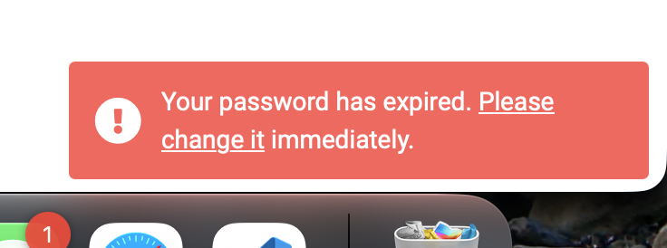

# iRedMail Password Expiry

A Roundcube plugin that checks the signed-in user's iRedMail mailbox password
expiration date and displays a notification when the password is nearing
expiration or has expired. The notification includes a link to Roundcube's
password-change action.

The plugin only displays a reminder; it does not enforce password expiration or
change passwords. See how to force password change in [iRedMail](https://docs.iredmail.org/force.user.to.change.password.html).

## Requirements

- Roundcube with this plugin enabled
- PHP with PDO and the PDO MySQL driver
- Read access to the iRedMail `vmail.mailbox` table
- A Roundcube password plugin/action available at
  `_task=settings&_action=plugin.password` for the change-password link

## Installation

1. Copy this directory into Roundcube's `plugins` directory, keeping the
   directory name `iredmail_password_expiry`.
2. Copy `config.inc.php.dist` to `config.inc.php` in the plugin directory.
3. Edit `config.inc.php` and set the database connection details and expiration
   policy (see [Configuration](#configuration)).
4. Add `iredmail_password_expiry` to the existing `$config['plugins']` array in
   Roundcube's main `config.inc.php`. Preserve any plugins already listed.
5. Ensure the configured database account can read
   `vmail.mailbox.passwordlastchange`.

## Configuration

The plugin's `config.inc.php` supports these settings:

| Setting | Default | Description |
| --- | --- | --- |
| `expiry_db_host` | `127.0.0.1` | MySQL server hostname or address |
| `expiry_db_name` | `vmail` | iRedMail mail database |
| `expiry_db_user` | `roundcube` | Database account used by the plugin |
| `expiry_db_password` | `CHANGE_THIS_PASSWORD` | Password for the database account |
| `expiry_days` | `90` | Number of days after the last password change when the password expires |
| `expiry_warning_days` | `10` | Show a notification when this many days or fewer remain |

Use the actual database credentials configured for your installation. Keep
`config.inc.php` private and do not leave the example password in place.

## Behavior

- The plugin looks up the signed-in Roundcube username in
  `vmail.mailbox.username` and reads `passwordlastchange`.
- It calculates expiration using `expiry_days` and displays a standard
  Roundcube notification at or below `expiry_warning_days`.
- Expired passwords receive an error notification; passwords nearing expiry
  receive a notice.
- The notification's “Please change it” link points to Roundcube's
  `settings/plugin.password` action. Ensure the password plugin that provides
  this action is installed and enabled.
- No notification is shown on the login page, for an unknown mailbox, or when
  `passwordlastchange` is unset or is MySQL's zero date.
- Database and other runtime errors are written to Roundcube's `errors` log.
